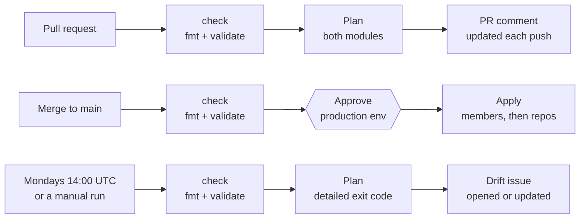

# Setting up OpenTofu CI for ardotconsulting/membership

Written 2026-10-31 by Ryan Cheley.

## Overview

The ardotconsulting GitHub org is now managed entirely through OpenTofu in CI. Every PR posts a plan, every merge to `main` applies after one approval, and a weekly check flags drift. This took ten PRs (#1 to #10) and one issue (#5). The first full apply finished with 0 resources destroyed.

The `ardotconsulting/membership` repo has two OpenTofu modules:

- `members/`: org membership, the `Admins` and `super-admins` teams, and the Security Manager role
- `repositories/`: the repos, plus three teams per repo

The pieces that make it run:

| Piece | What it does |
| --- | --- |
| `.github/workflows/tofu.yml` | `fmt`/`validate` on every PR, plan on PRs, apply on merge, weekly drift check |
| GitHub App `ardotconsulting-tofu` | Supplies a token that expires after an hour for managing the org |
| AWS OIDC role `github-actions-membership-tofu` | Gives CI access to state without stored AWS keys |
| S3 bucket `ardotconsulting-tofu-state` | Holds state for both modules, locked with `.tflock` files |
| `production` environment + `main` ruleset | One approval before an apply; required checks with no bypass |

Each row is one trigger. Only the merge row changes GitHub, and only after someone approves in `production`.

## Step 1: Fix the existing config and add docs

Reading the repo turned up four problems before any CI work started. They were fixed in PR #1, and PR #4 added a README.

1. `org.tfvars` set `organizational_teams`, but the variable is `organization_teams`, so any plan of `members/` would have failed. Renamed it.
2. `repositories/` had no backend, so its state was local. Added an S3 backend under key `repositories/tfstate.json`.
3. `repositories/variables.tofu` failed `tofu fmt -check`. Formatted it.
4. The `designers` variable was declared but never used. Removed it.

The same PR added `CLAUDE.md` (commands and architecture notes) and a `.gitignore` for `.terraform/` and `.DS_Store`. The README covers layout, prerequisites, apply order, and how to add members or repos.

## Step 2: Decide how CI authenticates and gates changes

Issue #5 listed five open decisions. Each went to the recommended default, and AWS stayed on S3 after looking at alternatives.

| Decision | Chosen | Why |
| --- | --- | --- |
| GitHub auth | GitHub App | Not tied to one person's account, tokens expire after 1 hour, uses no seat |
| AWS auth | OIDC, one role | No stored keys; one role is enough while there's a single admin |
| State storage | Stay on S3 | The bucket name was already in the config; the alternatives (R2, GCS, Postgres, a hosted service) cost a migration for little gain |
| Approvals | Required reviewer on `production`, plus a `main` ruleset with no bypass | Catches a plan that changed between PR review and merge, and enforces "never push to main" |
| Concurrency | One queue for applies and drift checks; one per PR | Applies never race; a new push cancels that PR's stale plan |
| Drift | Weekly plan that opens or updates an issue | A drift-triggered apply would quietly undo emergency manual changes |

Three facts shaped these choices: the repo is public, the org is on the free plan, and `main` had no protection.

## Step 3: Add the GitHub Actions workflow

One workflow file, `.github/workflows/tofu.yml`, has two jobs (PR #6, with the AWS step finished in PR #7).

- **`check`** runs on every PR and push: `tofu fmt -check -recursive`, then `init -backend=false` and `validate` for both modules. It needs no secrets.
- **`tofu`** depends on `check`, and what it does depends on the trigger:
  - Pull request: plans both modules and posts one PR comment, updated on each push
  - Push to `main`: applies `members/` first, then `repositories/`, in the `production` environment
  - Monday 14:00 UTC, or a manual run: `plan -detailed-exitcode`; on drift, opens or updates an issue

The `tofu` job is skipped until both `TOFU_APP_CLIENT_ID` and `TOFU_AWS_ROLE_ARN` are set, and always for PRs from forks, which don't get secrets. Every action is pinned to a commit SHA, and checkout keeps no credentials. `actionlint` (through Docker) and `zizmor` both pass.

PR #6 merged without the AWS commit. GitHub never attached the last push to the PR, so the merge used the older commit. PR #7 re-applied it.

## Step 4: Configure the repo settings

Two settings, made through the GitHub API, enforce the review flow.

**`production` environment**

- Required reviewer: `miloardot`. GitHub allows approving your own runs.
- Only `main` can deploy to it. This uses a custom branch policy rather than "protected branches only", which may not count rulesets as protection.

**`main` ruleset**

- Changes must go through a PR, with 0 approvals required, because a single admin can't approve their own PRs
- Squash merges only
- Required checks: `check`, plus `tofu` (added in step 9)
- Force-pushes and branch deletion are blocked
- No bypass actors, including admins

## Step 5: Create the GitHub App

The App `ardotconsulting-tofu` was created by hand. That needs an org owner and can't be scripted.

1. Go to Org settings → Developer settings → GitHub Apps → New GitHub App. Use the repo URL as the homepage, leave the callback URL empty, and **turn the webhook off**.
2. Set permissions:
   - Repository: Administration (read/write), Metadata (read)
   - Organization: Members, Administration, and Custom organization roles (all read/write)
3. Under "Where can this GitHub App be installed?", choose **Only on this account**.
4. Copy the **Client ID** (starts with `Iv23`; not the numeric App ID) and generate a private key.
5. Install the App on `ardotconsulting` with **All repositories**, so it can manage repos that OpenTofu creates later.
6. Store the credentials in the repo:
   - `gh variable set TOFU_APP_CLIENT_ID --body "Iv23…"`
   - `gh secret set TOFU_APP_PRIVATE_KEY < key.pem`

After that, move the `.pem` file into a password manager. The installed App also ended up with Contents and Pages write, which aren't needed now but would be if repos ever use `pages` or `template` settings.

## Step 6: Set up AWS

The bucket named in the config didn't exist yet, so everything was created from scratch in the org's AWS account (PR #8). The exact commands are in the README's "AWS setup" section.

1. **Fix the CLI.** `/usr/local/bin/aws` was a 2020 Intel build that can't run on Apple Silicon without Rosetta. `brew install awscli` put a native 2.39.3 first on `PATH`.
2. **Log in.** The old `[default]` access keys were rejected (`InvalidClientTokenId`), and `aws login` won't overwrite a profile that holds keys. `aws login --profile <name>` signed in with console credentials, as root, by choice, for this one-time setup.
3. **Create the bucket.** `ardotconsulting-tofu-state` in us-east-1, with versioning on, SSE-S3 encryption (the default), and all four public-access blocks on.
4. **Drop DynamoDB.** Both backends now use `use_lockfile = true` instead of `dynamodb_table`, which is deprecated in OpenTofu 1.10+. That's one less resource to create.
5. **Create the OIDC provider** for `token.actions.githubusercontent.com`, with audience `sts.amazonaws.com`.
6. **Create the role** `github-actions-membership-tofu`:
   - Trust (`aws/trust-policy.json`): same-repo PRs, `main`, and the `production` environment only
   - Inline policy `tofu-state` (`aws/state-policy.json`): get/put on the two state files, get/put/delete on their `.tflock` files, and list on the bucket
7. **Check the policy** with `aws iam simulate-principal-policy`. Writing state and deleting lock files are allowed. Deleting state, writing other keys, and creating buckets are all denied.
8. **Point CI at the role:** `gh variable set TOFU_AWS_ROLE_ARN --body arn:aws:iam::<ACCOUNT_ID>:role/github-actions-membership-tofu`.

## Step 7: Run the first plan and fix what it caught

The first real plan, on PR #8, needed five fixes. Two of them would have caused real damage if applied.

| Problem | Effect if applied | Fix |
| --- | --- | --- |
| `marketing-plan` had no `visibility`, so it got the `"public"` default | **The private marketing plan becomes public** | `visibility = "private"` |
| `ardotconsulting-site` had no `pages` or `homepage_url` | **Pages and the `www.ardotconsulting.com` domain removed; the site goes down** | Added `homepage_url` and `pages = { build_type = "workflow", cname = "www.ardotconsulting.com" }` |
| The trust policy expected `repo:ardotconsulting/membership:…` | AWS rejected the role (`Not authorized to perform sts:AssumeRoleWithWebIdentity`) | The repo uses GitHub's immutable subject, so the policy now uses `repo:ardotconsulting@350385434/membership@1441045555:…` |
| The `.github` repo didn't exist, but an `import` block ran for it | Plan failed: `Cannot import non-existent remote object` | Created the repo by hand with `gh repo create` |
| `data.github_team` looked up `Admins` | 404 | Look it up by the lowercase slug `admins` |

The `admins` 404 remained after that, because the team didn't exist until `members/` was applied. That's expected on the very first run only.

## Step 8: Run the first apply

It took two merges, both approved in `production`, to get everything applied.

1. **Merging PR #8** applied `members/` (6 added: membership, two teams, their members, and the Security Manager role). `repositories/` then failed during planning with `Insufficient members blocks`, so nothing on the repos changed.
2. **Cause:** `github_team_members` needs at least one `members` block, and no repo lists any people. PR #9 skips repos with nobody on them, the same filter the committers resource already used.
3. **Merging PR #9** applied `repositories/`: 6 imported, 21 added, 6 changed, 0 destroyed.

Checks afterwards:

- `marketing-plan` is still private.
- The site keeps its Pages `workflow` build, its custom domain and HTTPS, and returns HTTP 200.
- All three repos are squash-only, delete branches after merge, and have no direct collaborators.
- Each repo has `<repo>` (triage), `<repo>-committers` (maintain) and `<repo>-admins` (admin). The `.github` repo's teams use the slug `github`.
- `admins` keeps `pull` on every repo through the Security Manager role. The collaborators resource ignores that team.

One expected change: `miloardot` lost direct admin on two repos and kept access as an org owner.

## Step 9: Lock it in

Two follow-ups made the setup self-enforcing.

- **`tofu` became a required check** in the `main` ruleset. A PR whose plan fails can no longer merge.
- **PR #10 removed the one-time `import` blocks.** With everything in state they did nothing, and they would have failed the plan for any new repo. The README and `CLAUDE.md` now explain how to adopt an existing repo: add a temporary `import` block, apply, then remove it. PR #10 planned with no changes for both modules.

## Gotchas worth remembering

- **Missing settings fall back to defaults.** With `visibility` and `pages` left out, OpenTofu would have made a private repo public and taken the website down. Read the first plan of any imported resource line by line.
- **Check the OIDC subject format before writing a trust policy.** Run `gh api repos/<org>/<repo>/actions/oidc/customization/sub`. This repo uses immutable IDs, not names.
- **A job with an environment presents the environment to AWS, not the branch** (`…:environment:production`), so the trust policy lists it separately.
- **Confirm a PR's latest commit before merging.** GitHub once accepted a push without attaching it to PR #6. Check that `gh pr view --json headRefOid` matches your local `HEAD`.
- **`github_team_members` can't be empty.** Any resource that builds `members` blocks dynamically needs a `length(...) > 0` filter.
- **Import blocks are one-time.** Leaving them in breaks the plan for every new repo you add.
- **A manual run of the workflow is a drift check.** On a branch with pending changes it opens a false "drift detected" issue. Test changes with a PR instead.

## Reference

| Item | Value |
| --- | --- |
| OpenTofu | 1.13.2; provider `integrations/github` 6.9.0 |
| State bucket | `ardotconsulting-tofu-state` (us-east-1), keys `members/tfstate.json` and `repositories/tfstate.json` |
| IAM role | `github-actions-membership-tofu` (full ARN in the `TOFU_AWS_ROLE_ARN` repo variable) |
| GitHub App | `ardotconsulting-tofu`, installed on all repos |
| Repo variables | `TOFU_APP_CLIENT_ID`, `TOFU_AWS_ROLE_ARN` |
| Repo secret | `TOFU_APP_PRIVATE_KEY` |
| OIDC subject prefix | `repo:ardotconsulting@350385434/membership@1441045555` |
| Ruleset | `main` |

| PR | Change |
| --- | --- |
| [#10](https://github.com/ardotconsulting/membership/pull/10) | Remove the one-time import blocks |
| [#9](https://github.com/ardotconsulting/membership/pull/9) | Skip empty team member resources |
| [#8](https://github.com/ardotconsulting/membership/pull/8) | S3 lock files, immutable OIDC subject, keep repo visibility and Pages |
| [#7](https://github.com/ardotconsulting/membership/pull/7) | AWS OIDC role and policies (closed #5) |
| [#6](https://github.com/ardotconsulting/membership/pull/6) | GitHub Actions workflow |
| [#4](https://github.com/ardotconsulting/membership/pull/4) | README |
| [#1](https://github.com/ardotconsulting/membership/pull/1) | Config fixes and CLAUDE.md |
